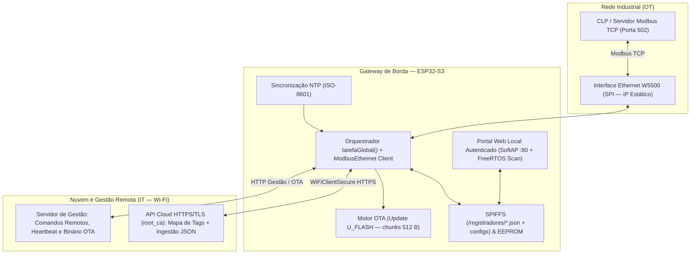
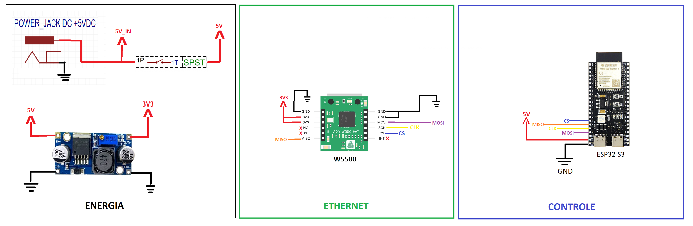

# ESP32 Industrial Modbus TCP to Cloud Gateway

### Gateway IIoT Dual-Network (Ethernet W5500 + Wi-Fi) para Coleta Dinâmica de CLPs, Telemetria HTTPS, OTA e Gabinete 3D


---

Gateway de borda **IIoT (Industrial Internet of Things)** baseado em **ESP32-S3** e controlador Ethernet **W5500**, projetado para atuar como ponte segura entre **CLPs industriais (Modbus TCP)** e plataformas em nuvem (**HTTPS/TLS** e gestão remota).

O firmware combina **descoberta e persistência dinâmica de registradores Modbus em JSON (SPIFFS)**, **sincronização temporal NTP**, **atualização remota de firmware OTA**, **portal web local autenticado com varredura Wi-Fi assíncrona em FreeRTOS** e **projeto mecânico 3D** pronto para impressão do gabinete.

<p align="center">
  
  <br>
  <em>Arquitetura de borda integrando rede industrial Modbus TCP (OT) a serviços em nuvem HTTPS/REST (IT) com provisionamento web local.</em>
</p>

---

## Sumário

1. [Visão Geral e Arquitetura do Sistema](#visão-geral-e-arquitetura-do-sistema)
2. [Hardware e Esquema Elétrico](#hardware-e-esquema-elétrico)
3. [Coleta Dinâmica Modbus TCP e SPIFFS](#coleta-dinâmica-modbus-tcp-e-spiffs)
4. [Integração em Nuvem HTTPS e Gestão Remota](#integração-em-nuvem-https-e-gestão-remota)
5. [Portal Web Embarcado e Provisionamento](#portal-web-embarcado-e-provisionamento)
6. [Atualização OTA e Console de Diagnóstico](#atualização-ota-e-console-de-diagnóstico)
7. [Gabinete Mecânico 3D](#gabinete-mecânico-3d)
8. [Requisitos de Compilação e Estrutura do Repositório](#requisitos-de-compilação-e-estrutura-do-repositório)
9. [Licença e Contato](#licença-e-contato)

---

## Visão Geral e Arquitetura do Sistema

Em ambientes fabris, conectar CLPs diretamente à internet compromete o isolamento da rede de automação (OT). Este gateway desacopla fisicamente as duas interfaces — **Ethernet SPI (W5500)** dedicada à comunicação determinística **Modbus TCP** com o CLP e **Wi-Fi STA** dedicado à telemetria **HTTPS/TLS** e orquestração remota — permitindo reconfigurar tags, IPs e firmware em campo sem intervenção física.



### Cadência Operacional (`tarefaGlobal()`)

| Rotina | Intervalo | Função |
| :--- | :--- | :--- |
| **Leitura Modbus + Upload Cloud** | Configurável (`/path_plc_time.txt`, padrão `60 s`) | Lê todos os registradores em `/registradores/*.json`, anexa `dt_time` (ISO-8601) e envia via HTTPS POST |
| **Sincronização de Mapa de Tags** | `10 s` | Consulta `getNeedUpdate()` e, se `needUpdate == "true"`, recarrega a tabela de registradores no SPIFFS |
| **Polling de Comandos Remotos** | `1,5 s` | Busca tarefas pendentes (`buscarAcoesWifi()`), executa a ação correspondente e confirma execução |
| **Heartbeat de Disponibilidade** | `20 s` | Reporta versão de firmware, IPs Wi-Fi/Ethernet, prioridade ativa e estado de I/O (`updateStatusWifi()`) |
| **Autorecuperação de Rede** | Contínuo | Monitora `contador_falhas_via_wifi` (`> 10` tenta reconexão) e `contador_reconect_wifi` (`> 3` executa `ESP.restart()`) |

---

## Hardware e Esquema Elétrico

O hardware foi dividido em três blocos bem definidos — **Energia**, **Ethernet** e **Controle** — com atenção especial ao isolamento da alimentação do controlador Ethernet:

<p align="center">
  
  <br>
  <em>Esquema elétrico de interligação: entrada 5 VDC com chave SPST, buck dedicado LM2596 (3,3 V para o W5500), interface Ethernet SPI W5500 e núcleo ESP32-S3.</em>
</p>

| Bloco | Componentes | Especificação e Decisão de Engenharia |
| :--- | :--- | :--- |
| **Energia** | Power Jack `+5 VDC` + Chave `SPST` + Conversor Buck `LM2596` (`5 V → 3,3 V`) | O rail `5 V` alimenta o `ESP32-S3`, enquanto o módulo Ethernet `W5500` recebe alimentação **`3,3 V` dedicada** via `LM2596`, evitando sobrecarga no LDO interno da placa controladora durante tráfego TCP contínuo. |
| **Ethernet OT** | Módulo `ADIY W5500 HAT` (Controlador `W5500`) | Interface **SPI** (`CS = GPIO10`, `SCK`, `MISO`, `MOSI`; `IRQ = GPIO9` e `RST = GPIO3` mapeados em `MakeParamsLocalSetup.h`) com referência `GND` comum. |
| **Controle** | `ESP32-S3-WROOM-1` (compatível com ESP32 / ESP8266 via `#ifdef`) | Processamento dual-core FreeRTOS, conectividade Wi-Fi integrada, suporte TLS (`WiFiClientSecure`) e partições SPIFFS/OTA. |

---

## Coleta Dinâmica Modbus TCP e SPIFFS

Em vez de fixar endereços Modbus no código-fonte, o gateway armazena cada ponto de coleta como um arquivo JSON individual em `/registradores/<plcPath>.json` no **SPIFFS**. Quando o backend sinaliza alteração no mapa de variáveis, `processarNovosRegistradores()` limpa o diretório e reescreve automaticamente a nova configuração.

### Tipos Modbus e Conversões Suportadas (`processarUploadRegistradores()`)

| `dataType` | Função `ModbusEthernet` | `valueType` Suportado | Tratamento de Leitura |
| :--- | :--- | :--- | :--- |
| **`COIL`** | `readCoil()` | Booleano | Leitura 1-bit (`true` / `false`), offset 0-based (`plcPath % 100 - 1`) |
| **`DISCRETE`** | `readIsts()` | Booleano | Leitura de entrada discreta (1-bit), offset 0-based |
| **`INPUT_REGISTER`** | `readIreg()` | `INTEGER` / `REAL` | `INTEGER`: 1 word (`uint16_t`); `REAL`: 2 words combinadas em ponto flutuante |
| **`HOLDING_REGISTER`** | `readHreg()` | `INTEGER` / `REAL` | `INTEGER`: 1 word (`uint16_t`); `REAL`: 2 words combinadas em ponto flutuante |

### Exemplo de Descritor no SPIFFS (`/registradores/40001.json`)

```json
{
  "name": "tempSensor",
  "plcPath": "40001",
  "dataType": "HOLDING_REGISTER",
  "valueType": "INTEGER"
}
```

### Mapa de Arquivos Persistidos no SPIFFS

| Caminho SPIFFS | Finalidade |
| :--- | :--- |
| `/path_plc_server.txt` / `/path_plc_port.txt` / `/path_plc_time.txt` | IP do CLP Modbus (padrão `192.168.10.11`), porta (`502`) e cadência de leitura em segundos (`60`) |
| `/path_ip_eth.txt` / `/path_gat_eth.txt` / `/path_sub_eth.txt` / `/path_config_eth.txt` | Endereçamento estático Ethernet (`W5500`) e flag de ativação |
| `/path_ip_wifi.txt` / `/path_gat_wifi.txt` / `/path_sub_wifi.txt` / `/path_config_wifi.txt` | Endereçamento estático Wi-Fi e flag de ativação |
| `/path_guid.txt.txt` | Número de série / identificador único do gateway (`SERIAL_NUMBER`) |
| `/registradores/` | Diretório dinâmico contendo os descritores JSON de cada registrador monitorado |

---

## Integração em Nuvem HTTPS e Gestão Remota

### Canais de Comunicação

1. **Canal Seguro HTTPS/TLS (`WiFiClientSecure` + `root_ca` em `Certificados.h`):**
   - Download da tabela de registradores (`getRegistradores()`) autenticado via headers `x-api-key` e `x-security-id`.
   - Ingestão de telemetria Modbus serializada com timestamp NTP ISO-8601 (`setUploadRegistradores()`) via `HTTPS POST` autenticado por `x-api-key`, `x-usual-id` e `x-tenet-id`.
2. **Canal de Gestão, Disponibilidade e Tarefas Remotas:**
   - Heartbeat periódico (`/v1/protected/modulopgm/informarOnlinePost/`), consulta de tarefas (`/v1/protected/modulopgm/tarefas/listar/`), confirmação de execução (`/v1/protected/modulopgm/tarefas/responder/`) e notificação de eventos/boot (`/v1/protected/modulopgm/tarefas/informar/`).

### Tabela de Comandos Remotos (`processarRequisicao()`)

| Gatilho / `tipo_requisicao` | Ação Executada no Gateway |
| :--- | :--- |
| `needUpdate == "true"` | Sincroniza novo mapa de registradores via HTTPS e dispara leitura/upload imediato |
| **`60`** | Confirma a tarefa e executa reinicialização remota (`ESP.restart()`) |
| **`70`** | Confirma a tarefa e inicia atualização de firmware **OTA** via Wi-Fi (`buscarAtt()`) |
| **`90`** | Cria ou sobrescreve arquivo arbitrário no SPIFFS (`writeFile(valorString1, valorString2)`) |
| **`115`** | Atualiza credenciais Wi-Fi (SSID/senha) na EEPROM e reinicia |
| **`116`** | Reconfigura IP estático, gateway e sub-rede **Ethernet** no SPIFFS e reinicia |
| **`118`** | Reconfigura IP estático, gateway e sub-rede **Wi-Fi** no SPIFFS e reinicia |
| **`119`** | Atualiza prioridade de interface de rede na EEPROM e reinicia |

---

## Portal Web Embarcado e Provisionamento

No boot, o gateway ativa o ponto de acesso local **`MODBUS RECEIVER <SERIAL_NUMBER>`** servindo uma interface web administrativa na porta **`80`** (`WebServerLocalSetup.h` e `WEBPAGES.h`).

- **Fluxo de Primeiro Uso e Autenticação:** quando `primeiro_uso_global == 0`, o portal exige o cadastro da senha administrativa (armazenada em `EEPROM`). Nos acessos subsequentes, todas as telas de configuração são protegidas pela rota de login.
- **Varredura Wi-Fi Assíncrona (FreeRTOS):** no ESP32, a rota `/update_wifi_list` executa `WiFi.scanNetworks()` em uma task dedicada (`xTaskCreatePinnedToCore` no Core 1), retornando os SSIDs via JSON em `/get_wifi_list` sem bloquear o loop de automação.
- **Conversor CIDR Integrado:** o formulário Wi-Fi aceita máscara em notação CIDR (ex.: `/24`) e realiza a conversão bit-a-bit via `mascaraParaSubmascara()` antes da gravação no SPIFFS.

| Rota HTTP | Função |
| :--- | :--- |
| `/` e `/action_define_password` | Definição inicial da senha administrativa (primeiro uso) ou tela de login |
| `/action_login` e `/main` | Autenticação de sessão e painel principal com status Wi-Fi/Ethernet, MACs e S/N |
| `/update_wifi_list` e `/get_wifi_list` | Disparo assíncrono (FreeRTOS) e consulta JSON da lista de redes Wi-Fi |
| `/action_new_connection` | Gravação de SSID/senha em EEPROM e IP estático Wi-Fi no SPIFFS |
| `/action_new_connection_eth` | Configuração de IP estático, gateway e máscara da interface Ethernet `W5500` |
| `/configs` e `/action_configs` | Configuração do endereço IP do servidor Modbus (CLP) e intervalo de coleta |
| `/opcoes` e `/action_opcoes` | Seleção de prioridade entre interfaces de rede |
| `/action_reset` | Reinicialização controlada com redirecionamento automático |

---

## Atualização OTA e Console de Diagnóstico

### Motor de Atualização OTA (`buscarAtt()`)

Ao receber o comando remoto **`70`**, o gateway:
1. Confirma o recebimento da tarefa no servidor.
2. Desabilita temporariamente o Task Watchdog (`esp_task_wdt_delete(NULL)` no ESP32) para evitar resets durante o download.
3. Baixa o binário via HTTP validando `Content-Length`, inicializa `Update.begin(length, U_FLASH)` e grava em streaming por blocos de **`512 bytes`** (`BUFFER_SIZE`).
4. Finaliza com `Update.end()` e reinicia automaticamente executando o novo firmware.

### Console de Diagnóstico Serial (`115200 bps`)

| Tecla | Ação Executada |
| :---: | :--- |
| `a` | Reinicia o microcontrolador (`ESP.restart()`) |
| `l` | Lista no console todos os registradores JSON salvos em `/registradores/` |
| `g` | Força consulta imediata de atualização (`getNeedUpdate()`) |
| `h` | Recarrega remotamente a tabela de registradores (`processarNovosRegistradores()`) |
| `u` | Executa ciclo manual de leitura Modbus TCP e upload HTTPS |
| `d` | Limpa todos os arquivos de `/registradores/` |

---

## Gabinete Mecânico 3D

O repositório inclui o projeto mecânico completo do invólucro protetivo do gateway para impressão 3D e customização em painel industrial:

| Arquivo | Formato | Descrição |
| :--- | :---: | :--- |
| [`case_esp32.stl`](./case_esp32.stl) | `.stl` | Malha pronta para fatiamento e impressão 3D do gabinete do gateway |
| [`case.blend`](./case.blend) | `.blend` | Projeto-fonte 3D editável no Blender para adaptação de recortes, fixação DIN ou dimensões |

---

## Requisitos de Compilação e Estrutura do Repositório

### Ambiente e Dependências

- **Placa alvo:** `ESP32-S3 Dev Module` / `ESP32 Dev Module` (Flash ≥ 4 MB, esquema de partição com suporte a **OTA** + **SPIFFS ≥ 1 MB**, `115200 baud`).
- **Bibliotecas:** `WiFi.h`, `WiFiClientSecure.h`, `WebServer.h`, `HTTPClient.h`, `Ethernet.h`, `SPI.h`, `ModbusEthernet`, `ArduinoJson` (v6+), `ArduinoHttpClient`, `SPIFFS.h`, `EEPROM.h`, `Update.h`.

> [!IMPORTANT]
> **Segurança em Produção:** antes de implantar o firmware em ambiente produtivo, substitua as URLs de API, chaves de autenticação (`x-api-key`, `x-security-id`, `x-usual-id`, `x-tenet-id`), senha administrativa padrão (`padroesFabrica()`) e credenciais do SoftAP em `ModbusTCPHTTPRequests.ino`, `MakeParamsLocalSetup.h` e `WebServerLocalSetup.h`, além de validar os certificados raiz em `Certificados.h`.

### Arquivos do Repositório

| Arquivo | Descrição |
| :--- | :--- |
| [`ModbusTCPHTTPRequests.ino`](./ModbusTCPHTTPRequests.ino) | Firmware principal: inicialização SPIFFS/NTP/Modbus, `tarefaGlobal()`, processamento de tarefas e leitor Modbus TCP |
| [`WebServerLocalSetup.h`](./WebServerLocalSetup.h) | Rotas HTTP do portal web, autenticação administrativa, clientes HTTPS/HTTP e motor OTA (`buscarAtt()`) |
| [`WifiLocalSetup.h`](./WifiLocalSetup.h) | Gestão Wi-Fi STA/EEPROM, task FreeRTOS de scan de redes, validação de IPs e inicialização Ethernet `W5500` |
| [`WEBPAGES.h`](./WEBPAGES.h) | Páginas HTML/CSS/JS embarcadas em memória Flash (`PROGMEM`) |
| [`FilesWriter.h`](./FilesWriter.h) | Camada de leitura, gravação, listagem e limpeza de arquivos e registradores JSON no SPIFFS |
| [`MakeParamsLocalSetup.h`](./MakeParamsLocalSetup.h) | Definições de pinagem `W5500` SPI, versão de firmware, MAC Ethernet e parâmetros de integração |
| [`AllMetods.h`](./AllMetods.h) | Protótipos centralizados das funções do projeto |
| [`Certificados.h`](./Certificados.h) / [`certs.h`](./certs.h) / [`certUpdate`](./certUpdate) | Certificados raiz TLS (`root_ca`) e utilitário auxiliar de geração de certificados |
| [`EthernetLocalSetup.h`](./EthernetLocalSetup.h) | Header reservado para extensões específicas de Ethernet |
| [`Esquema_Eletrico.png`](./Esquema_Eletrico.png) | Esquema elétrico completo (`ESP32-S3` + `W5500` + `LM2596`) |
| [`case_esp32.stl`](./case_esp32.stl) / [`case.blend`](./case.blend) | Gabinete mecânico 3D pronto para impressão e fonte Blender |
| [`README.md`](./README.md) | Documentação técnica do projeto |

---

## Licença e Contato

Distribuído sob a **MIT License** — livre para uso, modificação e distribuição mantendo os créditos originais.

- **Autor:** Aislan Silva Costa — Engenharia de Hardware, Sistemas Embarcados e IIoT
- **E-mail:** [comprasaislan@gmail.com](mailto:comprasaislan@gmail.com)
- **LinkedIn:** [linkedin.com/in/aislan-silva-costa-660814341](https://www.linkedin.com/in/aislan-silva-costa-660814341/)
